<div align="center">


# Station 256

**A file explorer for Windows where AI works in a sandbox, not on your PC.**

Station 256 looks and moves like Windows 11 File Explorer. Every project gets its own sealed *room*, and the AI tools you choose work inside it. They can reach that one project and nothing else: not your Windows files, not your other projects, not your home network.

[](https://www.electronjs.org)
[](https://learn.microsoft.com/windows/wsl/)
[](https://docs.docker.com/engine/)
[](https://nodejs.org)
[](https://www.microsoft.com/windows/windows-11)
[](LICENSE)

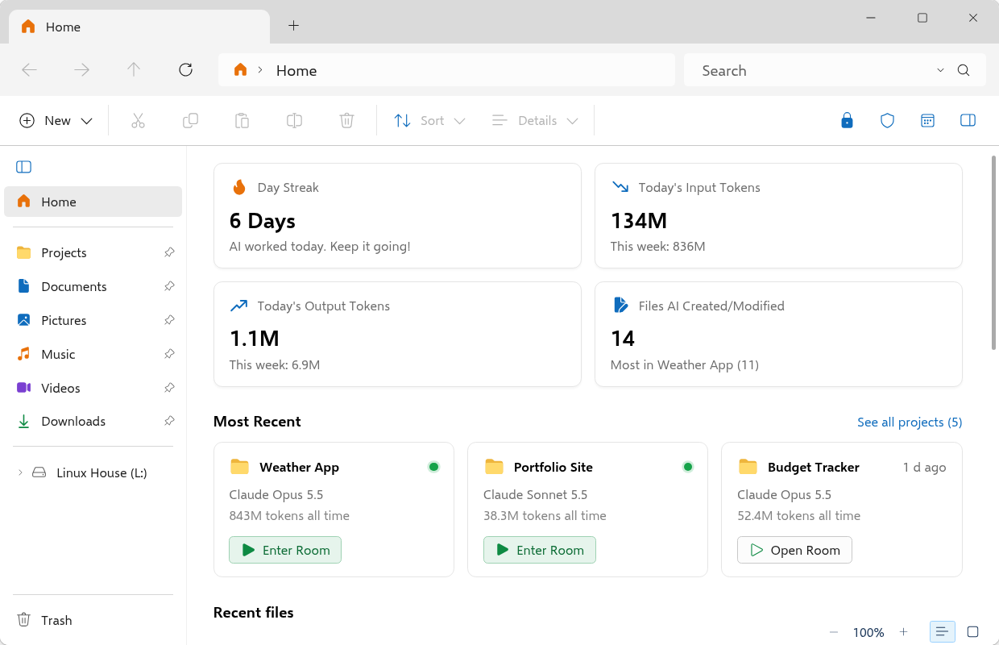

</div>

---

## Contents

- [Why](#why)
- [Highlights](#highlights)
- [Screenshots](#screenshots)
- [How it works](#how-it-works)
- [Requirements](#requirements)
- [Install](#install)
- [Choose your AI tools](#choose-your-ai-tools)
- [Using Station 256](#using-station-256)
- [Tech stack](#tech-stack)
- [Project structure](#project-structure)
- [Configuration](#configuration)
- [Security and privacy](#security-and-privacy)
- [Troubleshooting](#troubleshooting)
- [Roadmap](#roadmap)
- [Docs, contributing and licence](#docs-contributing-and-licence)

> **Status:** version 1.2.0. The one-command installer is new and has not yet been run end to end on a clean PC, so expect rough edges. The [manual steps](docs/02-rebuild-step-by-step.md) are still there if you prefer them.

## Why

AI coding tools are most useful when they can read, edit and run things. That is also what makes them risky on the same PC as your photos, documents and passwords.

Station 256 gives them somewhere safe to be. The AI sees one project folder and the internet, and that is all. You see everything it touches: which AI last edited each file, how many tokens it used, and every rule it follows.

## Highlights

- **A real file explorer.** Tabs, a sidebar, drag and drop, Trash with Restore, quick preview with Space, live folder updates, and a Home page with your projects and token use.
- **AI rooms.** One Docker container per project. Open a room and get a terminal in it. Terminals keep running when you close their tab.
- **You choose the AI.** Claude Code, Codex and Gemini are each optional. Tick the ones you use and only those are set up. Station 256 installs and signs in to nothing for you.
- **House rules.** One Allow / Ask / Block page that applies to every AI in every room.
- **See who changed what.** Every file shows which AI last edited it, which last read it, and its tokens.
- **Built-in viewers and editors.** PDF and Word (.docx) preview, pictures with a picture editor, a document editor, a video page and a video editor (built from OpenCut), and a song page that edits music tags and cover art.
- **A web browser.** Tabs, bookmarks, history, a start page, split view. A project's AI can use it while you watch, with a banner, a glow, its own named cursor and a Stop button that is always yours.
- **Local AI.** Run your own `.gguf` model on your own PC with llama.cpp. You bring the model.
- **Preview.** One click starts a project's website, including plain sites in `public/`, `site/`, `dist/`, `build/`, `docs/` or `www/`, and shows it in a tab.
- **Search.** By name across folders, by words inside text files, or by meaning (optional, needs your own key).
- **Right-click menus almost everywhere.** Files, Home, project cards, tabs, the sidebar, text boxes, terminals and web pages. Cut, Copy, Paste and Select All come first.
- **Schedules.** Repeat a command or an AI prompt while the house is awake.
- **Looks after itself.** It restarts after a crash, restarts a frozen page, and sets damaged settings files aside instead of losing them.
- **Sleeps when idle.** The house powers off after 10 minutes with nothing running, so it does not sit in memory.

## Screenshots

Every picture is the real app, shown with sample projects.

<table>
  <tr>
    <td width="50%">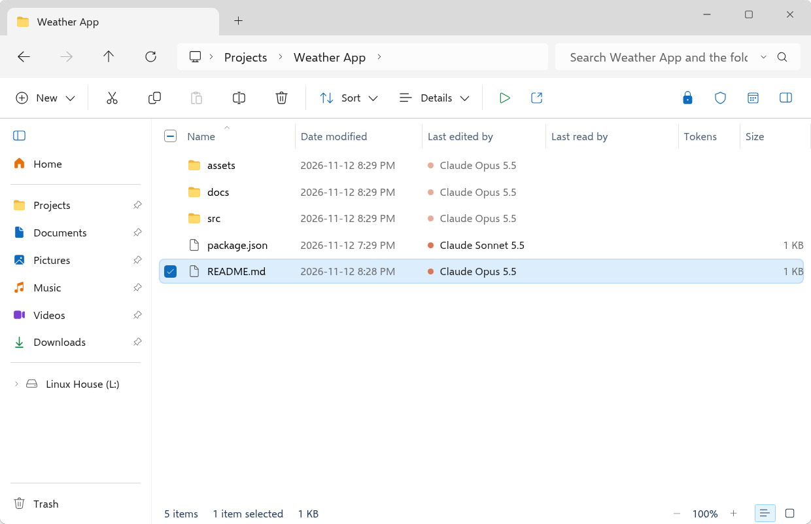</td>
    <td width="50%">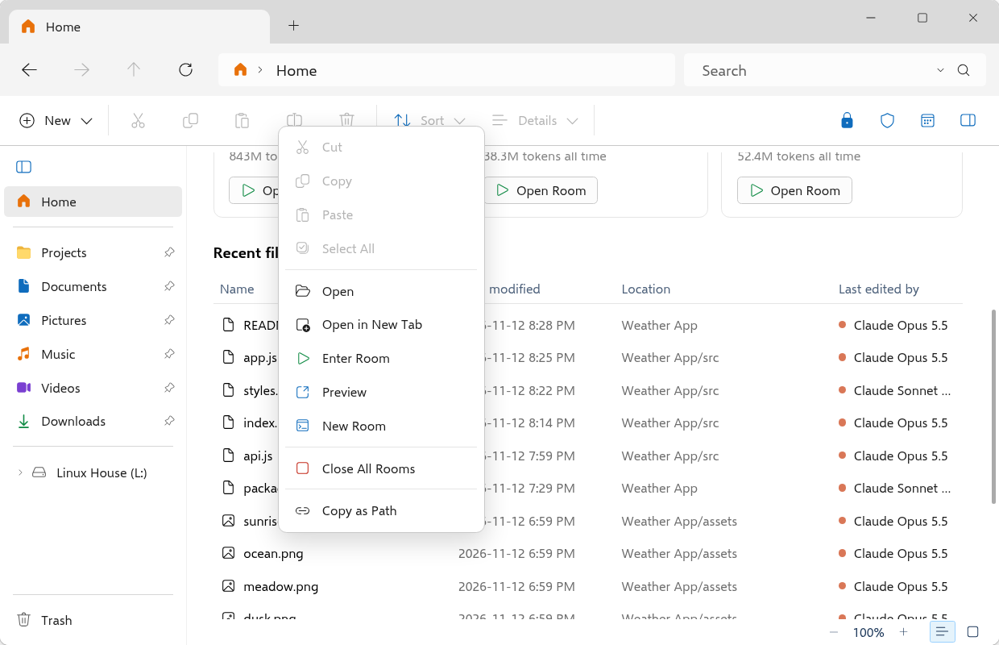</td>
  </tr>
  <tr>
    <td><b>See who changed what.</b> Every file shows the AI that last edited it, and its tokens.</td>
    <td><b>One right-click for a project.</b> Enter or open its room, preview its site, start a new room, close them all.</td>
  </tr>
  <tr>
    <td>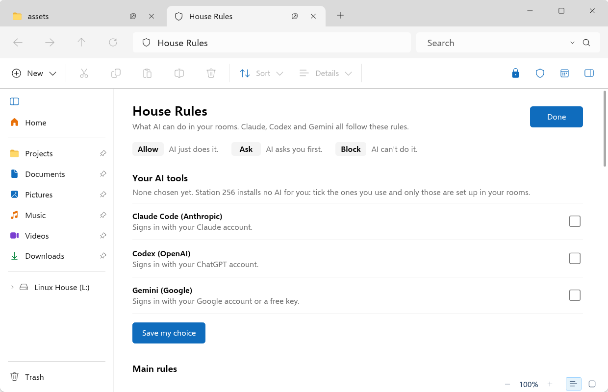</td>
    <td>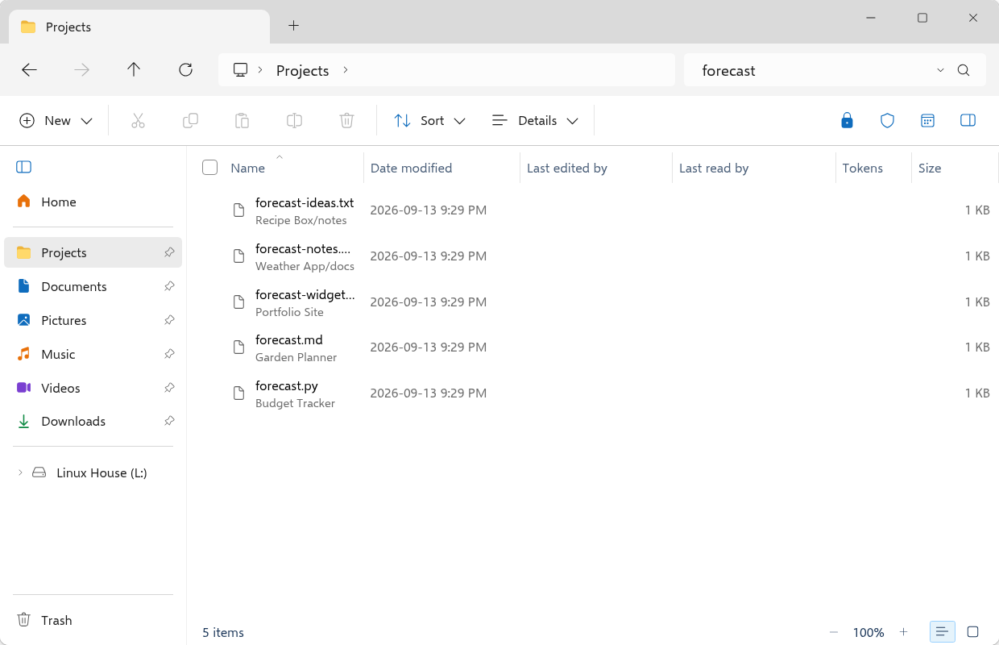</td>
  </tr>
  <tr>
    <td><b>You set the rules.</b> Internet, deleting files, installing packages, GitHub, passwords and more. One page covers every AI in every room.</td>
    <td><b>Search every project at once.</b> By name, by words inside files, or by meaning.</td>
  </tr>
  <tr>
    <td>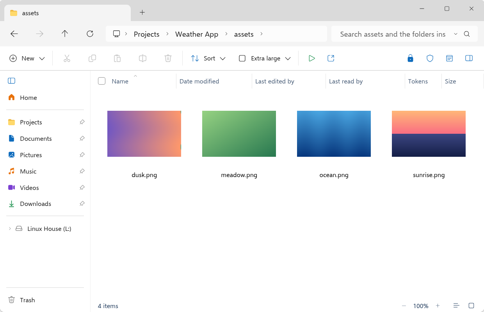</td>
    <td>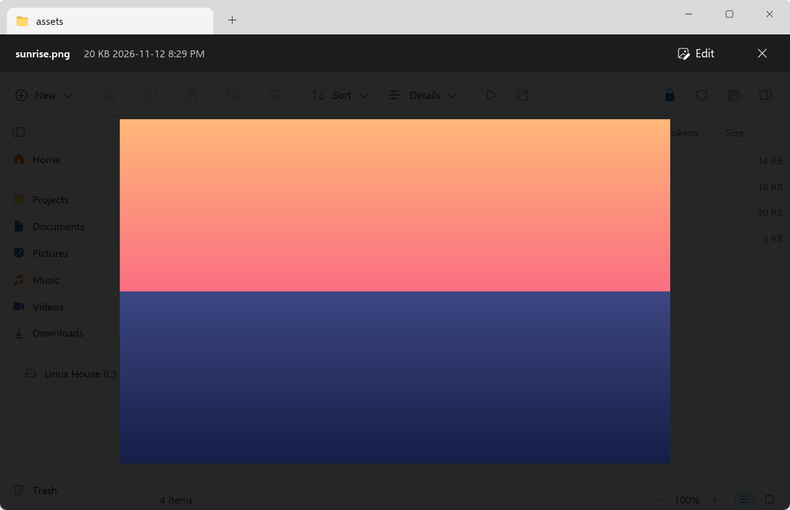</td>
  </tr>
  <tr>
    <td><b>Thumbnails at any size.</b></td>
    <td><b>Press Space to preview.</b> Pictures can be edited right there.</td>
  </tr>
  <tr>
    <td>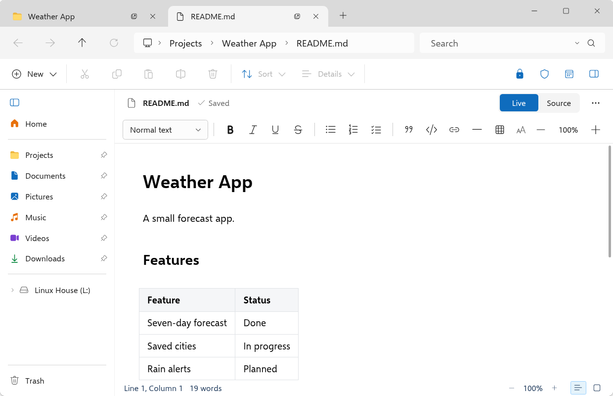</td>
    <td>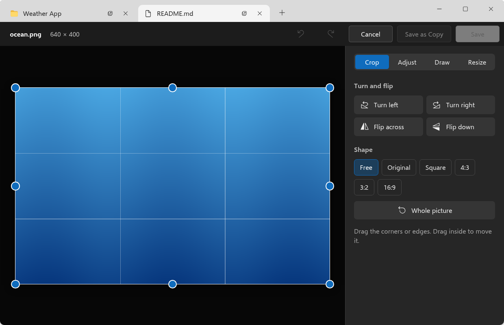</td>
  </tr>
  <tr>
    <td><b>Documents.</b> Live or source view, tables, checklists.</td>
    <td><b>Pictures.</b> Crop, adjust, draw and resize without another app.</td>
  </tr>
</table>

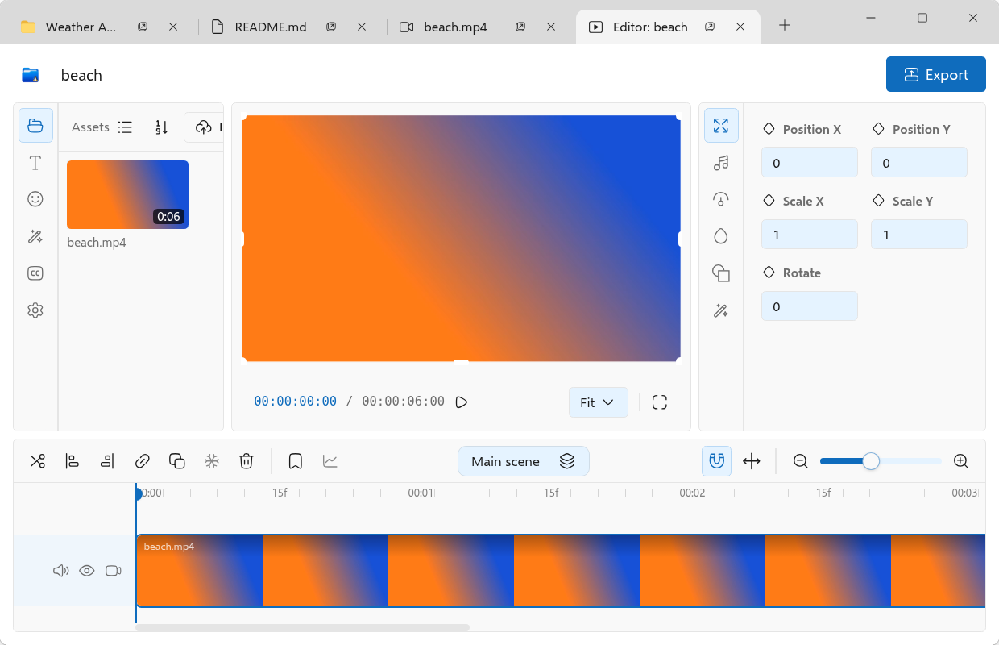

**The web browser, built in.** A start page with your bookmarks and recent sites, a bookmarks list, history, zoom, and split view.

<table>
  <tr>
    <td width="50%">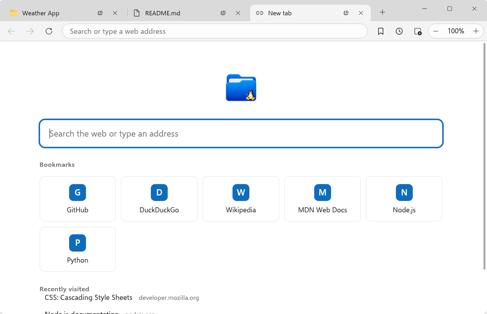</td>
    <td width="50%">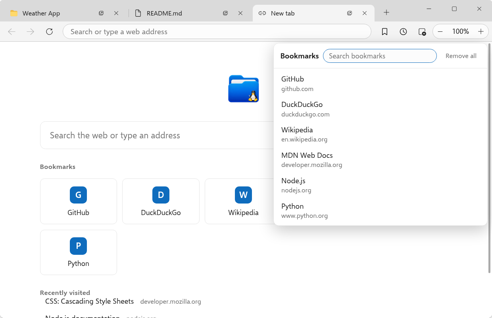</td>
  </tr>
  <tr>
    <td width="50%">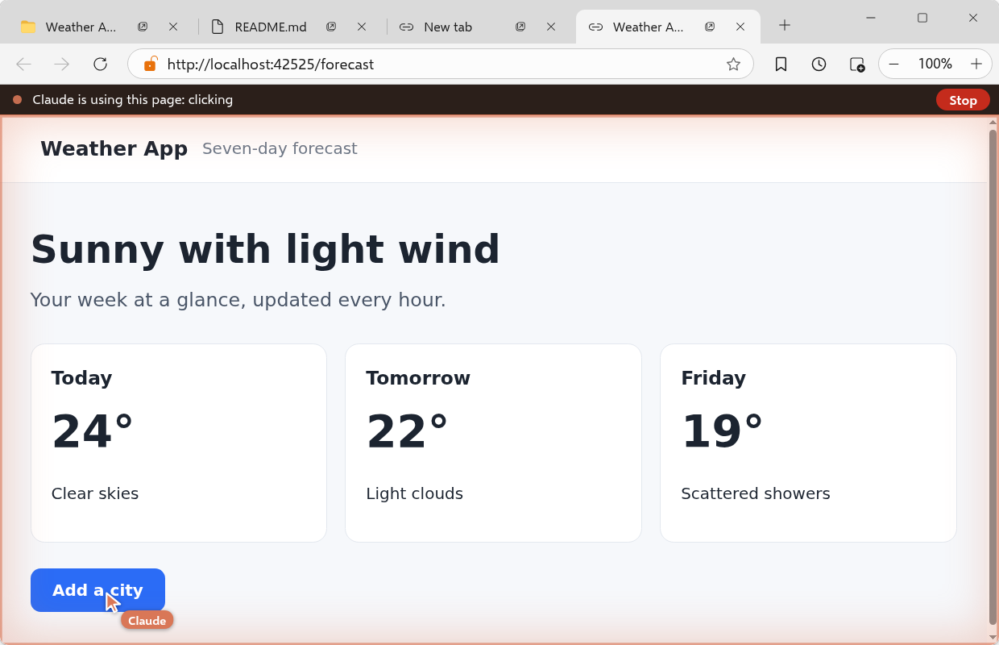</td>
    <td width="50%">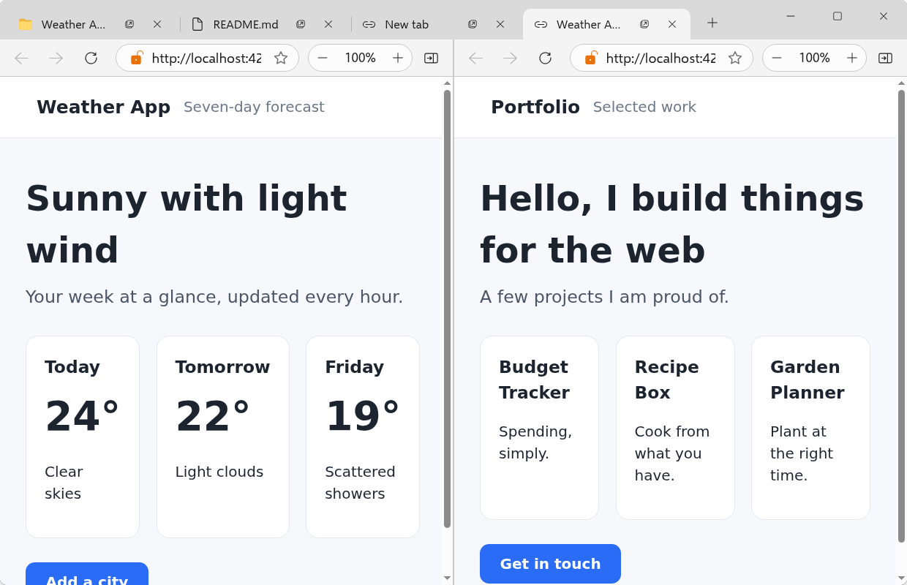</td>
  </tr>
  <tr>
    <td><b>You always see the AI.</b> A banner across the top, a glow, its own named cursor and a Stop button.</td>
    <td><b>Split view</b> puts two pages side by side.</td>
  </tr>
</table>

## How it works

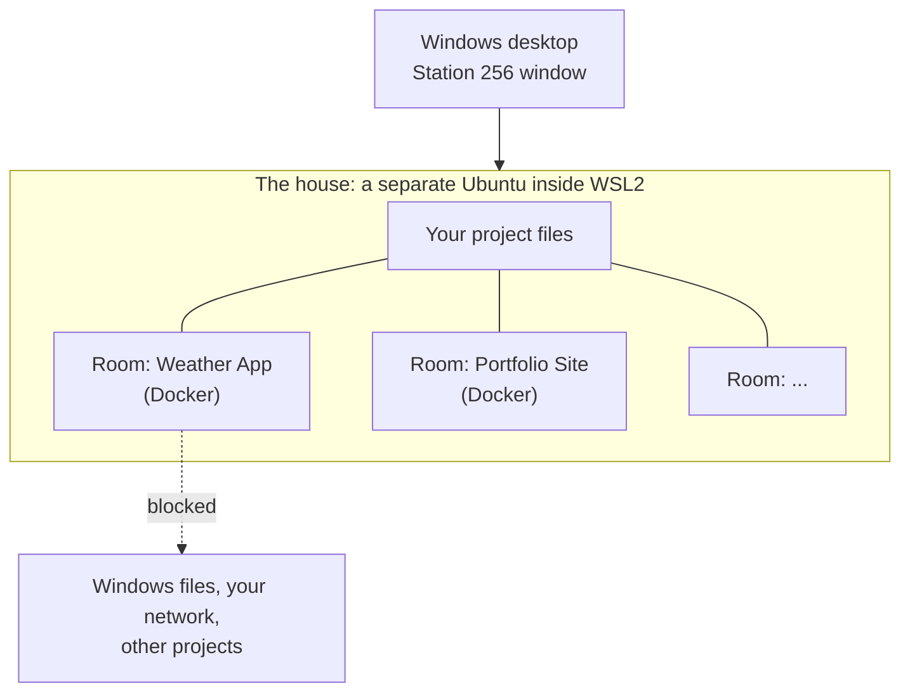

- **The house** is a small Ubuntu computer running inside Windows (WSL2). Your project files live there, not on the Windows side.
- **A room** is one Docker container for one project. It holds that project's folder and nothing else. It has no sudo.
- **Station 256** is the Electron app that controls both. It draws on your Windows desktop through WSLg and looks like File Explorer.
- **The three walls.** The Windows door (Ubuntu cannot see your Windows drives), the project door (a room sees only its own folder) and the network wall (rooms reach the internet but not Windows, your LAN or each other).

Read [docs/00-overview.md](docs/00-overview.md) first, then [docs/03-how-it-works.md](docs/03-how-it-works.md).

## Requirements

| Needs | Details |
|---|---|
| Windows | Windows 11. Windows 10 build 19045 or newer is the realistic minimum. |
| Virtualisation | Turned on in the BIOS. WSL2 will not run without it. |
| WSL | WSL2 with WSLg. Built and tested on WSL 3.0.3.0 with WSLg 1.0.79. |
| Linux | Ubuntu inside WSL. The installer sets up its own, so any Linux you already have is left alone. Built and tested on Ubuntu 26.04 LTS. |
| Docker | Docker Engine inside Ubuntu, not Docker Desktop. The installer sets it up. |
| RAM | 8 GB is the realistic minimum, 16 GB is comfortable. The idle house uses about 500 to 630 MB. |
| Disk | You choose how much space the house may grow to. 20 GB is the least that works, and the installer checks your free space. |
| Admin rights | Needed once, to turn on WSL. |
| Graphics | Any. A graphics card only helps the video editor, and Local AI if you have an NVIDIA card. |

The full list is in [docs/01-requirements.md](docs/01-requirements.md).

## Install

Open a normal PowerShell window and run one command:

```powershell
irm https://raw.githubusercontent.com/YOUR_GITHUB_USER/Station256/main/installer/get.ps1 | iex
```

**It asks you at most three things, once:**

1. **How much storage** the house may use. This is a limit you choose, not space set aside up front.
2. **A drive letter**, only if `L:` is already taken.
3. **A password** for the Linux side, typed twice and hidden.

**Then it does the rest by itself.** If WSL is not on yet, Windows needs one restart. The installer offers to do it, and when you sign back in, setup carries on and finishes on its own. You do not run the command again and you are not asked anything again. If WSL is already on, there is no restart.

**What it sets up**

- Its **own Linux**, named `Station256`. A Linux you already have is never touched.
- Docker Engine, Node.js and git inside it, plus Station 256 itself, the three walls and the sleep timer.
- The room blueprint.
- On Windows: a mapped drive (`L:`), Desktop and Start menu shortcuts, a right-click "Open Linux terminal here" on that drive only, and a step that puts the house to sleep when you sign in.

**What it does not do.** It installs no AI tool, signs in to nothing, and downloads no model. You choose those yourself, inside Station 256.

When it finishes, open **Station 256** from the Start menu. It starts empty, with no sample data.

To remove everything the installer made:

```powershell
powershell -NoProfile -ExecutionPolicy Bypass -File "$env:LOCALAPPDATA\LinuxHouse\installer\uninstall.ps1"
```

It asks before deleting the `Station256` Linux, because that deletes every file inside it. Add `-DryRun` to see what it would do without changing anything.

Prefer to do it by hand? The exact steps are in [docs/02-rebuild-step-by-step.md](docs/02-rebuild-step-by-step.md). How the installer works, step by step, is in [installer/README.md](installer/README.md).

## Choose your AI tools

Station 256 does not decide which AI you use. Open **House Rules** (the shield button) and look at **Your AI tools**:

| Tool | Maker | Signs in with |
|---|---|---|
| Claude Code | Anthropic | Your Claude account |
| Codex | OpenAI | Your ChatGPT account |
| Gemini | Google | Your Google account or a free key |

Tick the ones you use and press **Save my choice**. Only those are installed into your room blueprint. You sign in to each one yourself. Change your mind later and press **Apply**. Rooms you open next use the new set. Rooms already open keep what they had.

The same thing from a terminal in the house:

```bash
room ai set claude,codex   # any of: claude, codex, gemini
room build                 # applies it
room login                 # only if you use Claude: a one-time sign-in shared by all rooms
```

**Local AI is separate.** Station 256 does not include or download a model. Run your own `.gguf` file with llama.cpp from the **Local AI** page. If you want the llama.cpp program, `system/install-llama.sh` fetches it. Put your model in `~/models`.

## Using Station 256

- **Open it** from the Station 256 shortcut. **Alt+L** opens a new window, like Win+E for File Explorer.
- **Tabs.** Ctrl+T opens a new tab, Ctrl+W closes one. A tab can be moved to its own window and dragged between windows.
- **Files.** Space previews. F2 renames, Ctrl+C / Ctrl+X / Ctrl+V copy, cut and paste, Delete moves to the Trash, Alt+Enter opens Properties, F5 refreshes.
- **Rooms.** Right-click a project, then **Enter Room**. Closing a terminal tab only closes your view of it; what runs in it keeps going. In a terminal, `room new|open|close|list|status|ai|login|build` does the same things.
- **House rules.** The shield button opens the Allow / Ask / Block page.
- **The Windows lock.** The lock at the top right closes the door to Windows. While it is on, nothing can be copied or pasted between Linux and Windows in either direction, except a screenshot of Station 256 pasted into Station 256. Station tells you with a notice when something is stopped.
- **Search.** The search box's menu chooses This folder, All folders inside, or By meaning.
- **Zoom.** Footer zoom reads 100% by default and is remembered.

### Optional Wayland mode (smooth touchpad scrolling)

By default Station runs on X11. In Wayland mode a touchpad scrolls smoothly and pages stop cleanly at the top and bottom. Turn it on by starting Station with `HOUSE_OZONE=wayland`, or by putting the word `wayland` in `~/.config/house/ozone`. Remove either to go back.

## Tech stack

| Layer | Choice |
|---|---|
| App | [Electron](https://www.electronjs.org) 45.2.2, plain JavaScript |
| Terminals | [xterm.js](https://xtermjs.org) 6.0.0 with `node-pty` 1.1.0 |
| Video editor | [OpenCut](https://github.com/OpenCut-app/OpenCut) (Next.js 16, React 19, built with Bun 1.2.18) in `editor/` |
| Rooms | [Docker Engine](https://docs.docker.com/engine/) on Ubuntu 26.04, one container per project |
| House | [WSL2](https://learn.microsoft.com/windows/wsl/) Ubuntu, a firewall service and a keeper that sleeps it when idle |
| Windows half | PowerShell scripts and one C# file compiled in memory (never shipped as an `.exe`) |
| Look | Selawik (open font like Segoe UI) and Fluent icons, both bundled |
| Optional | [llama.cpp](https://github.com/ggml-org/llama.cpp) for Local AI, `ffmpeg` and `poppler-utils` for video, audio and PDF pictures |

Microsoft's Segoe UI and other Windows fonts are never copied or committed. Licences of the parts are those of each project; check upstream for current terms.

## Project structure

```
├── panel/            The Station 256 app: main.js, lib/ (back end), renderer/ (pages), tests
├── editor/           The video editor, built from OpenCut (MIT)
├── room/             The room blueprint (Dockerfile) and the tools mounted into rooms
├── bin/              The `room` command and small helpers
├── system/           Files installed into Ubuntu: wsl.conf, the sudoers rule, keeper defaults
├── windows/          The Windows half: helper scripts and window snapping
├── installer/        The one-command installer (PowerShell)
├── docs/             Overview, requirements, rebuild steps, how it works, decisions, tests
│   └── screenshots/  The pictures in this README
├── house-*.sh        The firewall, keeper and house rules services
└── *-test.sh         Safety, room, rules and web rule tests
```

## Configuration

Everything has a working default. Settings live in `~/.config/house/` inside the house.

| File | What it holds |
|---|---|
| `rules.json` | The House Rules choices |
| `ai-tools` | Which AI tools the rooms have, like `claude,codex` |
| `panel.json` | Window size and zoom |
| `llama.json` | Local AI settings (model, memory, graphics) |
| `ozone` | The word `wayland` to turn on Wayland mode |

API keys are kept in `~/.config/house`, readable only by you. The page only learns whether a key is saved.

## Security and privacy

**The three walls.**

1. **The Windows door.** Ubuntu is set up so a normal user cannot see or mount your Windows drives. Blocked by default.
2. **The project door.** A room has only its own project folder mounted. It cannot see other projects.
3. **The network.** Rooms sit on their own Docker network. The internet works, but Windows, your LAN, the house itself and other rooms are firewalled off.

Rooms also have no sudo and no Docker socket. House Rules writes permission files that are mounted read-only into every room for Claude, Codex and Gemini. Block beats Ask beats Allow.

**The Windows lock.** While it is closed (the default), nothing crosses between Linux and Windows. While you open it, Windows (C:) shows in the sidebar, read-only: you can browse, preview, open and copy from it, but nothing on C: can be renamed, deleted, moved, cut, zipped, extracted or pasted onto. It closes again when the house restarts.

**The honest limit.** Inside the house, `root` can still mount `C:`, and anyone in the `docker` group is effectively root without a password. The walls are real for anything running in a room, which is where AI runs. They are not a hard wall against something running directly in the house with Docker access.

**What stays local.** Your files, your projects, Local AI chats and the token counts stay on your PC. The browser's most-visited list, bookmarks and history stay on your PC.

**What can leave your PC.**

- AI tools in rooms talk to their own providers, as they normally do.
- "Search by meaning" is optional and needs your own key. It sends a file's name and up to 1,500 characters of its start to TypeSafe. Keys, sign-ins, settings folders, hidden files, other drives and text that looks like a password or token are never sent.
- A project's AI using the web browser works in the signed-in browser session, so it can act as you on sites you are signed in to. It cannot reach this PC or your home network, passwords and card fields are not exposed to it, and you can press Stop at any time. A public web name that points at a private address is not caught.
- Local AI listens only on `127.0.0.1`, with a random key each time it starts.

To report a vulnerability, see [SECURITY.md](SECURITY.md).

## Troubleshooting

- **The window does not draw.** Run `wsl --version`. If there is no WSLg line, run `wsl --update`.
- **Scripts will not run after editing from Windows.** Editing over `\\wsl.localhost` drops the execute bit. Run `chmod +x` on the scripts.
- **`/mnt/c` is missing in Ubuntu.** That is intended: the Windows door is closed by design.
- **Station closed by itself.** It restarts after a crash, but gives up after 4 crashes in 10 minutes. Look in `~/.local/state/house/panel.log` for lines starting with `[station]`.
- **The house keeps not sleeping.** An open room keeps it awake on purpose. Any `wsl` command also resets the 10 minute timer.
- **A room has no Claude, Codex or Gemini.** You choose them in House Rules > Your AI tools. Only ticked ones are installed.
- **Local AI says the model stopped by itself.** It usually ran out of memory. Use a smaller model or a smaller Memory size.
- **A black console window flashes on launch.** Shortcuts should run `conhost.exe --headless`, as in the rebuild steps.
- **Antivirus deletes a launcher.** This project uses PowerShell scripts and `.lnk` shortcuts for that reason, never compiled launchers.

More traps and fixes are in [docs/04-decisions-and-gotchas.md](docs/04-decisions-and-gotchas.md).

## Roadmap

- [ ] Run the installer end to end on a clean PC
- [ ] PDFs inside web pages in the browser
- [ ] A Windows-native version of the explorer (long term)

## Docs, contributing and licence

All documentation is in [`docs/`](docs/), best read in this order: [overview](docs/00-overview.md), [requirements](docs/01-requirements.md), [rebuild steps](docs/02-rebuild-step-by-step.md), [how it works](docs/03-how-it-works.md), [decisions and gotchas](docs/04-decisions-and-gotchas.md), [tests](docs/05-tests.md), [installer plan](docs/06-installer-plan.md).

See [CONTRIBUTING.md](CONTRIBUTING.md). Release history is in [CHANGELOG.md](CHANGELOG.md).

Station 256 is released into the public domain under [The Unlicense](LICENSE), except `editor/`, which is OpenCut under its own MIT licence (see `editor/LICENSE`).
