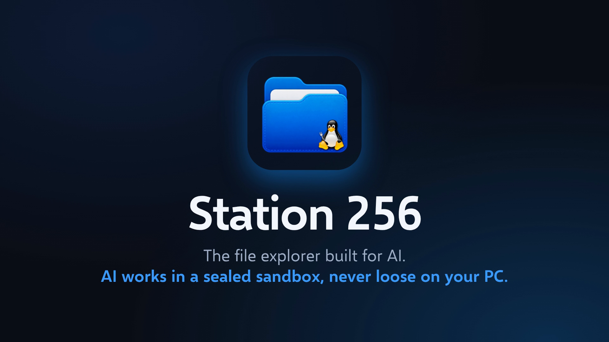

<p align="center">
  
</p>

<h1 align="center">Station 256</h1>

<p align="center"><strong>A file explorer for Windows with AI rooms, where AI works in a sandbox and not on your PC.</strong></p>

<p align="center">
  <a href="../../releases/latest"></a>
</p>

<p align="center">Watch the video tour: it is attached to the <a href="../../releases/latest">latest release</a>.</p>

Station 256 is an Electron app that looks and moves like Windows 11 File Explorer. It runs inside a WSL2 Ubuntu "house" and is drawn on your Windows desktop through WSLg. Each project can have a "room": a Docker container that holds only that project's folder, where AI tools such as Claude, Codex and Gemini can work without reaching your Windows files, your other projects or your home network.

> **Status:** version 1.1.0. There is now a **one-command installer**. It is new in this version and has not yet been run end to end on a clean PC, so expect rough edges (see [Install](#install)). The manual steps are still there if you prefer them.

## Highlights

- **File explorer.** Tabs, a sidebar, drag and drop, Trash with Restore, quick preview with Space, live folder updates, and a Home page with your projects and token use.
- **AI rooms.** One Docker container per project. Open a room and get a terminal with Claude, Codex or Gemini inside it. Terminals keep running when you close their tab.
- **House rules.** One Allow / Ask / Block page that applies to every AI in every room.
- **Built-in viewers and editors.** PDF and Word (.docx) preview, pictures (with a picture editor), a text and document editor, a video page and a video editor (built from OpenCut), and a song page that edits music tags and cover art.
- **Web Browser.** A built-in browser tab with a search box and tiles for the sites you visit most. A project's AI can use it through the `station-browser` room tool, while you watch and can press Stop.
- **Local AI.** Run small `.gguf` models on your own PC with llama.cpp, with Load and Unload buttons.
- **Preview.** One click starts a project's website (including plain sites in `public/`, `site/`, `dist/`, `build/`, `docs/` or `www/`) and shows it in a tab.
- **Search.** Search by name across folders, search for words inside text files, or search by meaning (optional, uses an outside service and your own key).
- **Right-click menus almost everywhere.** Files, Home, tabs, the sidebar, text boxes, terminals, Local AI and web pages. Cut, Copy, Paste and Select All come first.
- **Schedules.** Repeat tasks (a command or an AI prompt) that run while the house is awake.
- **Looks after itself.** It restarts after a crash, restarts a frozen page, and sets damaged settings files aside instead of losing them.
- **Sleeps when idle.** The house powers off after 10 minutes with nothing running, so it does not sit in memory.

## Requirements

| Needs | Details |
|---|---|
| Windows | Windows 11 (Windows 10 build 19045 or newer is listed as a realistic minimum) |
| Virtualisation | Turned on in the BIOS. WSL2 will not run without it. |
| WSL | WSL2 with WSLg. Built and tested on WSL 3.0.3.0 with WSLg 1.0.79. |
| Linux | Ubuntu inside WSL. Built and tested on Ubuntu 26.04 LTS. |
| Docker | Docker Engine installed inside Ubuntu (not Docker Desktop) |
| Node.js | Node.js 22 and npm, from Ubuntu's packages |
| Electron | 45.2.2 (installed by `npm install`) |
| RAM | 8 GB is the realistic minimum, 16 GB is comfortable. The idle house uses about 500 to 630 MB. |
| Disk | About 30 GB free as a minimum, more for real projects. The house's virtual disk is capped at 250 GB by default. |
| Admin rights | Needed once, for the first install (the WSL feature and Ubuntu) |
| Graphics | Any. A graphics card is only used by the video editor, and by Local AI if you have an NVIDIA card. |

See [docs/01-requirements.md](docs/01-requirements.md) for the full list.

## Install

Open a normal PowerShell window and run one command:

```powershell
irm https://raw.githubusercontent.com/YOUR_GITHUB_USER/Station256/main/installer/get.ps1 | iex
```

It asks three questions, and nothing else:

1. **How much storage** to allow. This is a limit, not a reservation.
2. **A drive letter**, only if `L:` is already taken. Otherwise the house uses `L:`.
3. **A password** for the Linux side, typed twice and hidden. It is never saved.

**What happens when you install**

1. It downloads the newest release and unpacks it in a temporary folder.
2. It looks at your PC (Windows version, virtualisation, memory, disk space).
3. It asks the three questions above, shows a summary, and asks `Go ahead? (Y/n)`.
4. It turns on WSL if needed. If Windows asks for a restart, restart and run the same command again. It carries on from where it stopped.
5. It installs its **own Linux, named `Station256`**. A Linux you already have (such as `Ubuntu`) is never touched.
6. Inside that Linux it makes your user, installs Docker Engine, Node, git and Claude Code, copies in Station 256, installs the walls and the sleep timer, and builds the room image.
7. On Windows it maps the drive, adds Desktop and Start menu shortcuts called "Station 256", a right-click "Open Linux terminal here" on that drive only, and a step that puts the house to sleep when you log in.
8. It checks everything and lists what is left for you. It cannot connect Claude for you: the first room you open asks you to.

If your PC needs WSL turned on, Windows asks for administrator permission once. Click Yes. When the installer is done, open **Station 256** from the Start menu. It opens empty, with no sample data.

What is still unproven: the installer has not yet been run end to end on a clean PC. Turning on WSL and creating the Linux user have only been dry-run. See `installer/README.md` and `installer/STATUS.md`.

To remove everything the installer made, run:

```powershell
powershell -NoProfile -ExecutionPolicy Bypass -File "$env:LOCALAPPDATA\LinuxHouse\installer\uninstall.ps1"
```

It asks before deleting the `Station256` Linux, because that deletes every file inside it. Add `-DryRun` to see what it would do without changing anything.

### Manual setup (advanced)

Prefer to do it by hand? The full, exact steps are in [docs/02-rebuild-step-by-step.md](docs/02-rebuild-step-by-step.md).

Optional: install Local AI with `system/install-llama.sh` (see [Local AI](#local-ai)).

## What install does

This is every change made to your machine, whether you use the installer or the manual steps.

**On Windows**

- Turns on the WSL feature and installs the Ubuntu distribution (first install only, needs a restart if WSL was not already on).
- Creates `~\.wslconfig` with `instanceIdleTimeout=-1`, so the house keeper inside Ubuntu decides when to sleep.
- Maps a network drive (the docs use `L:`) to `\\wsl.localhost\Ubuntu`, persistent.
- Creates `%LOCALAPPDATA%\LinuxHouse\` with the helper scripts: `open-panel.ps1`, `house-helper.ps1`, `snap-link.cs` (compiled in memory, never shipped as an `.exe`), `open-here.ps1`, `sleep-at-login.ps1`, `station-keys.ps1` and the app icon.
- Imports registry entries under the current user (HKCU) only: a run-at-logon entry that sleeps the house once per sign-in, a run-at-logon entry for the `Alt+L` listener, a right-click "Open Linux terminal here" entry limited to the house drive, and a record of the drive mapping.
- Creates Desktop and Start menu shortcuts that run `conhost.exe --headless` with `open-panel.ps1`.
- A local link between the two halves on `127.0.0.1:47256`, protected by a secret that is generated on first run.

**In Ubuntu (the house)**

- Writes `/etc/wsl.conf`: systemd on, Windows drives not mounted, Windows programs cannot be started, Windows PATH not added.
- Adds Docker's apt repository and installs Docker Engine, containerd, buildx and compose. Adds your user to the `docker` group.
- Installs `git`, `nodejs`, `npm`, `python3`, `python3-pip`, `fontconfig`, `iptables`, `ffmpeg` and `poppler-utils`.
- Installs three scripts in `/usr/local/sbin` (`house-rules`, `house-firewall`, `house-keeper`) and a sudoers file that lets the panel run `house-rules` and nothing else. `house-rules` accepts only three fixed words: `door-open`, `door-close` and `firewall-check`.
- Installs and enables two systemd services, `house-firewall` and `house-keeper`, and a defaults file `/etc/default/house-keeper`.
- Links Claude's managed settings at `/etc/claude-code/managed-settings.json`, so house rules apply to Claude in the house too.
- Creates `~/house` (the code), `~/projects`, `~/.config/house`, `~/.local/state/house` and `~/.local/bin`, and links `room` into `~/.local/bin`.
- Creates a Docker network `house-rooms` (`172.30.0.0/24`) and the image `house-room:latest`. The image is Ubuntu 26.04 with a non-root `dev` user, no sudo, and Claude Code, Codex 0.167.0, Gemini CLI 0.67.0, Herdr and Graphify installed.
- If you install Local AI: llama.cpp and a 2.5 GB model go under your home folder (see [Local AI](#local-ai)). No sudo is needed for that.

Nothing is installed with an antivirus exclusion, and no compiled launcher is shipped.

## Dependencies

Versions below come from `panel/package.json` and `editor/package.json`.

| Name | Version | Purpose | Licence |
|---|---|---|---|
| Electron | 45.2.2 | The app shell | MIT |
| @xterm/xterm | 6.0.0 | Terminal display | MIT |
| @xterm/addon-fit | 0.11.0 | Fits terminals to their tab | MIT |
| @xterm/addon-unicode11 | 0.9.0 | Unicode width for terminals | MIT |
| node-pty | 1.1.0 | Starts terminal programs | MIT |
| Selawik | bundled | Open font that looks like Segoe UI | SIL Open Font Licence |
| Fluent icons | bundled | Icons | MIT |
| OpenCut | in `editor/` | The video editor (Next.js 16.1.3, React 19, built with Bun 1.2.18) | MIT |
| Docker Engine | from Docker's apt repository | Runs the rooms | Apache-2.0 |
| llama.cpp | release b12283 (optional) | Local AI server | MIT |
| Qwen3-4B-Instruct-2507 (Q4_K_M) | optional model | Default Local AI model | Apache-2.0 |
| ffmpeg, poppler-utils | from Ubuntu | Video, audio and PDF pictures | Their own licences |
| Node.js, npm, git, Python 3 | from Ubuntu | Tooling | Their own licences |

The licence column is taken from each project's own licence, not from this repository. Check upstream for the current terms. Microsoft's Segoe UI and other Windows fonts are never copied or committed.

## Usage basics

- **Open it** from the Station 256 shortcut on the Desktop or Start menu. Station starts on the Home page.
- **Alt+L** opens a new Station 256 window, like Win+E for File Explorer. If Station is not running, it starts it.
- **Tabs.** Ctrl+T opens a new tab (on Home), Ctrl+W closes one. With two or more tabs open, a tab can be moved to its own window, and tabs can be dragged between windows.
- **Files.** Space opens the quick preview. F2 renames, Ctrl+C / Ctrl+X / Ctrl+V copy, cut and paste, Delete moves to the Trash, Alt+Enter opens Properties, F5 refreshes, Ctrl+R restarts the window.
- **Rooms.** Open a project to start its room. A room has its own terminal tabs. Closing a terminal tab only closes your view of it; what runs in it keeps going. The command line tool is `room new|open|close|list|status|login|build`.
- **House rules.** The Rules button opens the Allow / Ask / Block page. The rules apply to every AI in every room.
- **Search.** The search box's menu chooses This folder, All folders inside, or By meaning. "Words inside files" finds text files by what they say.
- **Zoom.** Footer zoom reads 100% by default. Size and zoom are remembered in `~/.config/house/panel.json`.

### Local AI

Run `system/install-llama.sh` in Ubuntu. It downloads a pinned llama.cpp release (the NVIDIA CUDA build if your graphics driver supports it, otherwise the plain CPU build) into `~/.local/share/llama.cpp`, links `llama-server` into `~/.local/bin`, and downloads a 2.5 GB model into `~/models` unless that folder already has a `.gguf` file. Set `LLAMA_FLAVOR=cpu` to force the CPU build, or `LLAMA_MODEL=none` to skip the model. It is safe to run again. Then open it in Station from the New menu, then Local AI.

### Optional Wayland mode (smooth touchpad scrolling)

By default Station runs on X11. In Wayland mode a touchpad scrolls smoothly, follows your fingers, and pages stop cleanly at the top and bottom. It is opt-in. Turn it on either way:

- start Station with the environment variable `HOUSE_OZONE=wayland`, or
- put the single word `wayland` in the file `~/.config/house/ozone` (every way of starting Station reads it).

For the correct taskbar icon in Wayland mode, `panel/start.sh` writes `~/.local/share/applications/station-256.desktop`. WSLg does not read that folder, so also copy the file into the system folder (needs sudo):

```bash
sudo cp ~/.local/share/applications/station-256.desktop /usr/share/applications/
```

To go back to the default, remove the `ozone` file and the variable.

## Project layout

| Folder | What it holds |
|---|---|
| `panel/` | The Station 256 app: Electron main process (`main.js`), `lib/` for the back end, `renderer/` for the pages, `start.sh`, tests, assets |
| `editor/` | The video editor, built from OpenCut (MIT) |
| `room/` | The room blueprint (`Dockerfile`) and tools mounted into rooms, such as `station-browser` |
| `bin/` | The `room` command and small helpers |
| `system/` | Files installed into Ubuntu: `wsl.conf`, the sudoers rule, keeper defaults, `install-llama.sh` |
| `windows/` | The Windows half: helper scripts, `wslconfig`, snapping code |
| `installer/` | The early PowerShell installer (not proven on a clean PC) |
| `docs/` | Requirements, rebuild steps, how it works, decisions and traps, tests |
| `backup-tools/` | Maintainer scripts for backing up the project and its projects folder |
| `house-*.sh`, `house-*.service` | The firewall, keeper and house rules services |
| `*-test.sh` | Safety, room, rules and web rule tests |

Start with [docs/00-overview.md](docs/00-overview.md), then [docs/03-how-it-works.md](docs/03-how-it-works.md).

## Security and privacy

**The three walls.**

1. **The Windows door.** Ubuntu is set up so a normal user cannot see or mount your Windows drives. Blocked by default.
2. **The project door.** A room has only its own project folder mounted. It cannot see other projects.
3. **The network.** Rooms sit on their own Docker network. The internet works, but Windows, your LAN, the house itself and other rooms are firewalled off.

Rooms also have no sudo and no Docker socket. The House Rules page writes permission files that are mounted read-only into every room for Claude, Codex and Gemini. Block beats Ask beats Allow.

**The C: lock.** The Windows lock is closed by default. While you open it, Windows (C:) shows in the sidebar, read-only: you can browse, preview, open and copy from it, but nothing on C: can be renamed, deleted, moved, cut, zipped, extracted or pasted onto. The lock closes again when the house restarts.

**The honest limit.** Inside the house, `root` can still mount `C:`, and anyone in the `docker` group is effectively root without a password. The walls are real for anything running in a room, which is where AI runs. They are not a hard wall against something running directly in the house with Docker access.

**What stays local.** Your files, your projects, Local AI chats and the token counts stay on your PC. The Web Browser's most-visited list stays on your PC. API keys are kept in `~/.config/house`, readable only by you, and the page only learns whether a key is saved.

**What can leave your PC.**

- AI tools in rooms talk to their own providers, as they normally do.
- "Search by meaning" is optional and needs your own key. It sends a file's name and up to 1,500 characters of its start to TypeSafe. Keys, sign-ins, settings folders, hidden files, other drives and text that looks like a password or token are never sent.
- A project's AI using the Web Browser works in the signed-in browser session, so it can act as you on sites you are signed in to. It cannot reach this PC or your home network, passwords and card fields are not exposed to it, and you can press Stop at any time. A public web name that points at a private address is not caught.
- Local AI listens only on `127.0.0.1` with a random key per start.

To report a vulnerability, see [SECURITY.md](SECURITY.md).

## Troubleshooting

- **The window does not draw.** Run `wsl --version`. If there is no WSLg line, install or update WSL (`wsl --update`) first.
- **Scripts will not run after editing from Windows.** Editing over `\\wsl.localhost` drops the execute bit. Run `chmod +x` on the scripts.
- **`/mnt/c` is missing in Ubuntu.** That is intended. The Windows door is closed by design.
- **Station closed by itself.** `panel/start.sh` restarts it after a crash, but gives up after 4 crashes in 10 minutes. Read `~/.local/state/house/panel.log` (inside Ubuntu) and look for lines that start with `[station]`.
- **Rooms or the house keep not sleeping.** An open room keeps the house awake on purpose. Any `wsl` command also resets the 10 minute timer.
- **After updating `house-keeper.sh`.** Install it again: `sudo install -m 755 ~/house/house-keeper.sh /usr/local/sbin/house-keeper && sudo systemctl restart house-keeper`.
- **Local AI says the model stopped by itself.** This usually means it ran out of memory. Use a smaller model or a smaller Memory size.
- **A black console window flashes on launch.** Shortcuts should run `conhost.exe --headless` as described in the rebuild steps.
- **Antivirus deletes a launcher.** Do not use compiled launchers. This project uses PowerShell scripts and `.lnk` shortcuts for that reason.

More traps and fixes are in [docs/04-decisions-and-gotchas.md](docs/04-decisions-and-gotchas.md).

## Contributing

See [CONTRIBUTING.md](CONTRIBUTING.md). Release history is in [CHANGELOG.md](CHANGELOG.md).

## Licence

Station 256 is released into the public domain under [The Unlicense](LICENSE), except `editor/`, which is OpenCut under its own MIT licence (see `editor/LICENSE`).
