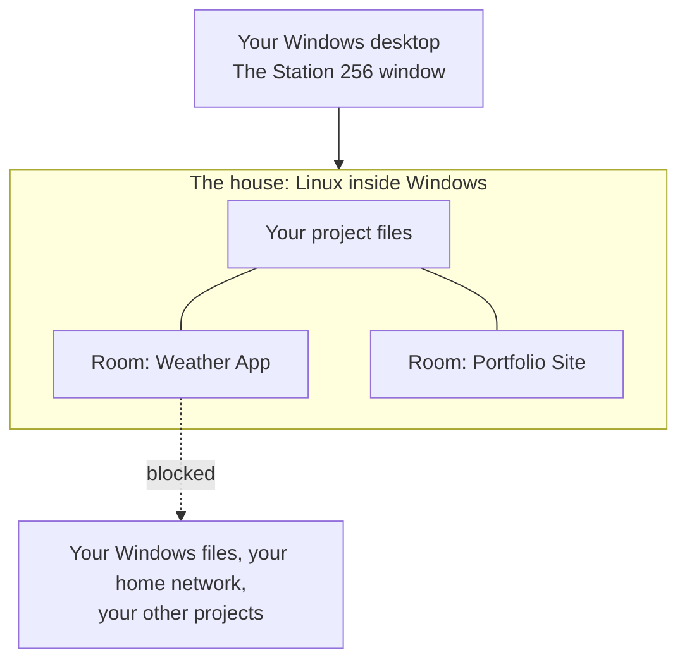

<div align="center">


# Station 256

**File Explorer just got better.**

A new-age file explorer for Windows developers. It runs in its own Linux sandbox,
so your projects, and the AI that helps you build them, stay in one safe place,
away from the rest of your PC.

[](https://www.electronjs.org)
[](https://learn.microsoft.com/windows/wsl/)
[](https://docs.docker.com/engine/)
[](https://www.microsoft.com/windows/windows-11)
[](LICENSE)

[Why](#why) · [What you get](#what-you-get) · [Screenshots](#screenshots) · [Install](#install) · [Tech stack](#tech-stack)

<br />


<sub><b>Home.</b> Your day at a glance: your streak, the tokens your AI used today, and the projects you worked on last.</sub>

</div>

---

## Why

File Explorer has barely changed in years. It was never updated for a world where AI writes code next to you.

Station 256 is what I wanted File Explorer to be. I built it as my own workspace: the one place where I develop and build all my projects. It is a file explorer, a project manager and a task manager in a single window.

Three ideas hold it together:

- **It feels like home.** It looks and moves like Windows 11 File Explorer, so there is nothing new to learn.
- **It is a real sandbox.** Station 256 lives in Linux, inside Windows. Your projects live there too. Each project gets its own room, and AI only ever works inside a room. A lock in the top right is the door to Windows. While it is locked, nothing goes in or out.
- **No more "Open with".** Pictures, videos, PDFs, Word files, zip files, songs and web pages open right inside it, with the tools to edit them built in.

It started as my own setup. Now any Windows developer can install it with one command.

## What you get

| | |
| --- | --- |
| **A file explorer you already know** | Tabs, a sidebar, drag and drop, Trash with Restore, and a Home page for your projects. A side panel shows how much CPU, memory and storage is in use. |
| **A room for every project** | Each project gets its own sealed room. The AI works in there and can see that one project, and nothing else. |
| **You pick the AI** | Claude Code, Codex and Gemini are all optional. Tick the ones you use. Station 256 installs none of them for you and signs in to nothing. |
| **House rules** | One page decides what AI may do: Allow, Ask or Block. It covers the internet, deleting files, installing packages, GitHub and passwords, for every AI in every room. |
| **The lock** | One button closes the door between Linux and Windows. While it is on, nothing can be copied or pasted across. |
| **See what the AI did** | Every file shows which AI last edited it, which one last read it, and how many tokens it used. |
| **Open anything, no extra apps** | PDFs, Word files, pictures, videos, songs and zip files all open inside Station 256. |
| **Edit without leaving** | A document editor, a picture editor, a video editor, and a song page for titles and cover art. |
| **A web browser built in** | Tabs, bookmarks, history and split view. Your AI can use the browser too, while you watch, and the Stop button is always yours. |
| **Preview a project** | One click starts a project's website and shows it in a tab. |
| **Search three ways** | By file name, by the words inside files, or by meaning. Search by meaning is optional. It uses Jev, a model hosted by TypeSafe, and needs your own TypeSafe key. |
| **Terminals that keep running** | Close a room's terminal tab and the work inside keeps going. Come back and pick up where you left off. |
| **Local AI** | Run an AI model on your own PC with llama.cpp. You bring the model file. |
| **Schedules** | Run a command or an AI prompt again and again, on a timer, while the Linux side is awake. |
| **Easy on your PC** | The Linux side goes to sleep after 10 minutes with nothing running, so it does not sit in memory. |

## Screenshots

Every picture is the real app, shown with sample projects.

<table>
  <tr>
    <td width="50%"></td>
    <td width="50%"></td>
  </tr>
  <tr>
    <td><b>Who changed what.</b> Each file names the AI that last edited it, so you always know where a change came from.</td>
    <td><b>One right-click.</b> Enter a project's room, preview its website or close its rooms, all from one menu.</td>
  </tr>
  <tr>
    <td></td>
    <td></td>
  </tr>
  <tr>
    <td><b>Your rules.</b> Tick the AI tools you use, then choose what they may do. One page covers every room.</td>
    <td><b>Find it fast.</b> One search looks through every project at once, so you never dig through folders.</td>
  </tr>
  <tr>
    <td></td>
    <td></td>
  </tr>
  <tr>
    <td><b>See your pictures.</b> Thumbnails at any size make the right picture easy to spot.</td>
    <td><b>Press Space.</b> A full preview opens at once, with no other app, and Edit is one click away.</td>
  </tr>
  <tr>
    <td></td>
    <td></td>
  </tr>
  <tr>
    <td><b>Write documents.</b> Edit notes and README files as they will look, with tables and checklists.</td>
    <td><b>Fix a picture.</b> Crop, adjust, draw and resize without opening another program.</td>
  </tr>
  <tr>
    <td></td>
    <td></td>
  </tr>
  <tr>
    <td><b>Browse inside.</b> A start page with your bookmarks and recent sites, so the web stays in the sandbox too.</td>
    <td><b>Keep your places.</b> Bookmarks and history are saved on your PC and are easy to search.</td>
  </tr>
  <tr>
    <td></td>
    <td></td>
  </tr>
  <tr>
    <td><b>Watch the AI work.</b> A banner, a glow and its own named cursor show what it is doing. Stop is always yours.</td>
    <td><b>Side by side.</b> Split view puts two pages next to each other, like your app and its docs.</td>
  </tr>
</table>

<div align="center">


<sub><b>Cut a video.</b> Trim, arrange and export on a real timeline, without leaving your files.</sub>

</div>

## How it works



- **The house** is a small Linux computer that runs inside Windows. Your projects live there, not on the Windows side.
- **A room** is a sealed box for one project. The AI works inside it and cannot get out.
- **Station 256** is the window you use. It shows up on your Windows desktop like any other app.

Three walls keep things apart:

1. **The Windows door.** Linux cannot see your Windows drives. It is shut unless you open the lock.
2. **The project door.** A room holds one project. It cannot see your other projects.
3. **The network wall.** A room can reach the internet. It cannot reach Windows, your home network or other rooms.

## Install

**You need:** Windows 11, 8 GB of memory (16 GB is comfortable) and at least 30 GB of free space. The full list is in [docs/01-requirements.md](docs/01-requirements.md).

Open PowerShell and run one command:

```powershell
irm https://raw.githubusercontent.com/cleaneramade/Station256/main/installer/get.ps1 | iex
```

**It asks you up to three things, once:**

1. **How much storage** Station 256 may use. You type the amount. It is a limit, not space taken up front.
2. **A drive letter**, only if `L:` is already taken.
3. **A password** for the Linux side.

**Then it does the rest by itself.** If Linux is not turned on in Windows yet, Windows needs one restart. The installer offers to do it. When you sign back in, setup carries on by itself and finishes. You do not run the command again and you are not asked anything again.

**What it sets up:** its own Linux (any Linux you already have is left alone), the tools Station 256 needs inside it, a drive letter that opens it, Desktop and Start menu shortcuts, a right-click "Open Linux terminal here" on that drive, and a step that lets the Linux side sleep when you sign in.

**What it leaves to you:** it installs no AI tool, signs in to nothing and downloads no AI model. You choose those in Station 256.

### Already have it? Run the same command to update

The installer checks for Station 256 before it does anything else. If it finds it, it skips the questions and only updates the app's own files. Your projects, settings, rooms, drive and shortcuts are left as they are. If you already have the newest version, it tells you and changes nothing.

### Remove it

```powershell
powershell -NoProfile -ExecutionPolicy Bypass -File "$env:LOCALAPPDATA\LinuxHouse\installer\uninstall.ps1"
```

It asks before it deletes anything, because removing the Linux removes the files inside it.

The installer is new. A first install on a brand-new PC, and an update of a copy it installed, have been walked through as dry runs but not yet run for real. If it trips, [the manual setup](docs/02-rebuild-step-by-step.md) does the same job by hand.

## Choose your AI

Station 256 does not decide which AI you use. Open **House Rules** (the shield button) and tick the ones you want:

| Tool | Made by | You sign in with |
| --- | --- | --- |
| Claude Code | Anthropic | Your Claude account |
| Codex | OpenAI | Your ChatGPT account |
| Gemini | Google | Your Google account or a free key |

Press **Save my choice**. Only the ones you ticked are set up in your rooms, and you sign in to each one yourself. You can change your mind at any time.

**Local AI is separate.** Station 256 does not come with an AI model and does not download one. Put your own model file (`.gguf`) in the `models` folder of your Linux home and open **Local AI** from the New menu.

## Tech stack

| Part | What it does here |
| --- | --- |
| [Electron](https://www.electronjs.org) 45 | The app itself. Its built-in Chromium also runs the web browser and shows PDFs. |
| [WSL2](https://learn.microsoft.com/windows/wsl/) with Ubuntu | The house: the Linux that runs inside Windows. |
| [Docker Engine](https://docs.docker.com/engine/) | The rooms: one sealed container per project. |
| [Herdr](https://herdr.dev) | Keeps each room's terminals running when you close their tabs, and lists your AI agents on the Agents page. |
| [xterm.js](https://xtermjs.org) and node-pty | The terminals you see in tabs. |
| [CodeMirror](https://codemirror.net) 6 | The document and code editor. |
| [OpenCut](https://github.com/OpenCut-app/opencut-classic) | The video editor (Next.js and React, in `editor/`). |
| [Graphify](https://github.com/Graphify-Labs/graphify) | Maps each project's code inside its room, so an AI finds things faster. |
| ffmpeg and poppler | Video and song edits, and the small pictures of videos and PDFs. |
| Python 3 | Reads Word files and zip files, using only what Python comes with. |
| [llama.cpp](https://github.com/ggml-org/llama.cpp) | Optional. Runs Local AI on your own PC. |
| Jev by TypeSafe | Optional. Powers search by meaning, with your own key. |
| Claude Code, Codex, Gemini | Optional. The AI tools you choose for your rooms. |
| PowerShell and one C# file | The Windows side: the installer, shortcuts and window snapping. |

Fonts and icons are open ones: Selawik for text, Station Mono (made from Cascadia Code) for terminals, and Fluent icons. Microsoft's Segoe UI is never copied.

## Project structure

```
├── panel/            The Station 256 app: the pages, the logic and the tests
├── editor/           The video editor, built from OpenCut
├── room/             The room blueprint and the tools that go into every room
├── bin/              The `room` command
├── installer/        The one-command installer
├── windows/          The Windows side: helper scripts and window snapping
├── system/           Settings files for the Linux side
├── docs/             How it works, requirements, manual setup, tests
│   └── screenshots/  The pictures in this README
├── house-*.sh        The firewall, the sleep timer and the house rules
└── *-test.sh         Safety tests for the rooms, the rules and the walls
```

## Privacy and safety

**What stays on your PC.** Your files, your projects, your Local AI chats, your token counts, and the browser's bookmarks and history.

**What can leave your PC.**

- The AI tools you choose talk to their own makers, the same as they do anywhere else.
- Search by meaning is off unless you add your own TypeSafe key. When you use it, it sends each file's name and the first 1,500 characters of text files to TypeSafe's Jev. Passwords, keys, sign-ins, settings folders and hidden files are never sent.
- An AI using the built-in browser works in your signed-in browser, so it can act as you on sites you are signed in to. It cannot reach your PC or your home network, it cannot read password or card boxes, and you can press Stop at any time.

**The honest limit.** The walls are built for what runs in a room, and that is where AI runs. A program that you run on the Linux side yourself, outside a room, is not held by them.

To report a security problem, see [SECURITY.md](SECURITY.md).

## Troubleshooting

- **The window does not show up.** Run `wsl --update` in PowerShell, then open Station 256 again.
- **A room has no Claude, Codex or Gemini.** Tick the ones you use in House Rules. Only ticked ones are installed.
- **Linux cannot see my C: drive.** That is on purpose. The Windows door is shut unless you open the lock.
- **Station 256 closed by itself.** It restarts after a crash, but stops trying after 4 crashes in 10 minutes. Open it again from the Start menu.
- **Local AI says the model stopped by itself.** It most likely ran out of memory. Try a smaller model.

## Docs and licence

The docs are in [`docs/`](docs/): [overview](docs/00-overview.md), [requirements](docs/01-requirements.md), [manual setup](docs/02-rebuild-step-by-step.md), [how it works](docs/03-how-it-works.md) and [tests](docs/05-tests.md). To help out, read [CONTRIBUTING.md](CONTRIBUTING.md). What changed in each version is in [CHANGELOG.md](CHANGELOG.md).

Station 256 is free for anyone to use and change, under [The Unlicense](LICENSE). The video editor in `editor/` is OpenCut and keeps its own MIT licence (see `editor/LICENSE`).
